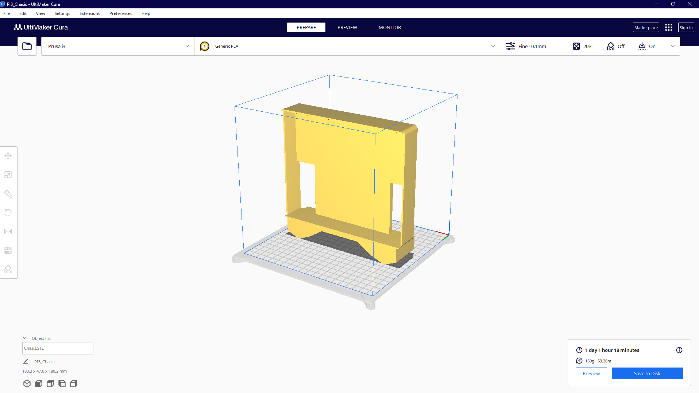
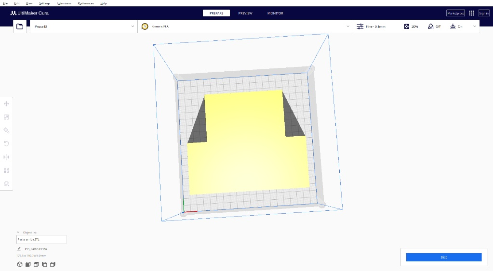

# Proyecto 1: KickOff - Vehículo Controlado por Bluetooth (Fútbol RC)

**Asignatura:** Introducción a la Mecatrónica  
**Autores:** Emmanuel Justo Flores -208048, Romina Velarde Mata -207345  
**Fecha:** Octubre 2026  

## 1. Contexto y Objetivo del Proyecto

El objetivo principal de este proyecto es diseñar, construir y programar desde cero un vehículo a control remoto operado mediante comunicación Bluetooth a través de un dispositivo móvil (Android). Este proyecto representa la integración culminante de los conocimientos adquiridos durante el curso: electrónica básica, uso de microcontroladores (ESP32), control de actuadores mecánicos (motores DC con Puente H), sistemas de potencia y diseño mecánico asistido por computadora (CAD).

El desarrollo tiene como meta final la participación del vehículo en un torneo competitivo de **fútbol RC 1v1**, sirviendo como introducción práctica a la robótica móvil, la resolución de problemas en tiempo real y el trabajo en equipo bajo estrictas restricciones de diseño.

---

## 2. Diseño Mecánico y Manufactura 3D (SolidWorks y Cura)

Para cumplir con las regulaciones de la competencia, el chasis del vehículo no fue un ensamble genérico, sino que fue **diseñado a la medida utilizando SolidWorks** y preparado para manufactura aditiva (impresión 3D).

* **Restricción de Huella:** El diseño se acotó meticulosamente para no superar las dimensiones máximas de $20 \times 20\text{ cm}$, garantizando agilidad y maniobrabilidad en la cancha de fútbol.
* **Modelado del Chasis Principal:** Se diseñó una base sólida (*PI3_Chasis*) que incluye anclajes específicos para los motores TT (evitando el uso de adhesivos temporales), compartimentos de seguridad para la batería LiPo y soportes fijos para el ESP32 y el driver TB6612FNG, logrando un manejo de cables limpio.
* **Tapa Superior y Marcador ArUco:** Se diseñó una pieza superior (*PI3_Parte arriba*) que actúa como tapa de protección para la electrónica y provee una superficie totalmente plana, horizontal y despejada de al menos $6 \times 6\text{ cm}$. Esta plataforma está destinada a alojar un marcador fiducial ArUco para futuras integraciones de visión por computadora.
* **Manufactura:** Las piezas fueron segmentadas y preparadas en **Ultimaker Cura** para ser fabricadas mediante impresión 3D (FDM) utilizando filamento PLA. Esto proporcionó un equilibrio óptimo entre ligereza (para mayor aceleración) y resistencia estructural a los impactos durante los partidos.

A continuación se muestran las vistas previas del laminado en Ultimaker Cura:





### Archivos de Fabricación 3D (Descargas)

Descarga los modelos originales en formato STL listos para imprimir:

* [📥 Descargar diseño del Chasis (.STL)](../recursos/imgs/Chasis_2.STL)
* [📥 Descargar diseño de la Parte Superior (.STL)](../recursos/imgs/Parte%20arriba_2.STL)

---

## 3. Control Inalámbrico y Aplicación Móvil

Para la interfaz de usuario y el envío de comandos hacia el microcontrolador, se utilizó un dispositivo Android corriendo la aplicación **Arduino Bluetooth Control**. 


Esta aplicación permite emparejar el teléfono directamente con el módulo Bluetooth Classic del ESP32 y configurar botones en un mando virtual (*gamepad*). Al presionar o soltar los botones, la app envía los caracteres predefinidos en nuestro protocolo hacia el vehículo sin latencia perceptible.

---

## 4. Arquitectura de Hardware y Asignación de Pines

Para garantizar la máxima estabilidad del sistema y evitar conflictos de arranque (*Wrong boot mode*), se seleccionaron salidas puras libres de restricciones (*strapping pins*) para controlar el **Driver TB6612FNG**.

| Pin ESP32 | Pin Driver TB6612 | Función Principal | Justificación Técnica | 
| :---: | :---: | :--- | :--- | 
| **GPIO 23** | **STBY** | Habilitación del driver | Despierta el circuito lógico. Si está en `LOW`, los motores se desconectan. | 
| **GPIO 22** | **PWMA** | Velocidad Motor Izquierdo | Soporta modulación por ancho de pulso (PWM) pura. | 
| **GPIO 21** | **AIN1** | Dirección Izquierda 1 | Salida digital segura, sin interferencia en la memoria flash. | 
| **GPIO 19** | **AIN2** | Dirección Izquierda 2 | Salida digital segura, libre de *strapping pins*. | 
| **GPIO 18** | **PWMB** | Velocidad Motor Derecho | Soporta modulación por ancho de pulso (PWM) pura. | 
| **GPIO 27** | **BIN1** | Dirección Derecha 1 | Salida digital segura. | 
| **GPIO 26** | **BIN2** | Dirección Derecha 2 | Salida digital segura. | 

---

## 5. Alimentación y Seguridad Eléctrica

El sistema maneja dos flujos de energía totalmente independientes para proteger el "cerebro" (ESP32) del "músculo" (Motores):

1. **Circuito de Potencia (Batería LiPo 7.6V):** La batería Tattu de 450 mAh se conecta exclusivamente al pin **VM** (Voltage Motor) del puente H a través de un **interruptor físico (Switch)**. Esto permite cortar la fuerza motriz de los motores de inmediato en caso de emergencia sin apagar el microcontrolador.
2. **Circuito Lógico:** El ESP32 se alimenta independientemente (ej. vía USB o Power Bank), y provee **3.3V** al pin **VCC** del driver para que sus compuertas lógicas operen correctamente.
3. **Tierra Común (GND):** Es obligatorio unir físicamente la masa de la batería, del driver y del ESP32 para que las señales digitales de control tengan una referencia eléctrica estable y el ruido de los motores no reinicie el microcontrolador.

!!! warning "Precauciones Críticas con la Batería LiPo"
    Las baterías de polímero de litio son altamente volátiles y requieren un manejo riguroso:
    * **Peligros:** Un cortocircuito, perforación o exposición a altas temperaturas puede provocar fuego incontrolable.
    * **Sobredescarga:** Nunca permitir que el voltaje baje de los 6.8V en total (3.4V por celda). Descargarla en exceso provoca el "efecto globo" (hinchazón) y la destruye químicamente, volviéndola un riesgo de incendio.
    * **Carga Segura (Cargador B3):** Solo debe cargarse utilizando el puerto de balanceo en un cargador dedicado (como el B3 Compact 20W). La batería está lista para usarse **únicamente cuando todos los LEDs (Cell 1 y Cell 2) cambian a color VERDE fijo**. *Jamás se debe dejar cargando sin supervisión.*

---

## 6. Lógica de Control (Cero Bloqueos y Failsafe)

El programa fue estructurado bajo la filosofía de **cero bloqueos**. El microcontrolador nunca se queda esperando con funciones como `delay()`. En cada iteración del bucle principal (`loop`), el sistema realiza las siguientes tareas de forma ultra-rápida:

1. **Lectura Bluetooth No Bloqueante:** Se revisa si hay datos disponibles. De ser así, se leen mediante `readStringUntil('\n')`, se sanean con `.trim()` para eliminar retornos de carro, y se interpretan al instante.
2. **Mapeo y Matemática de Movimiento:** Un switch case traduce caracteres (`F`, `B`, `L`, `R`, etc.) en configuraciones de pines `IN1`/`IN2`. Para las curvas (`G`, `H`, `I`, `J`), la llanta interna gira a $v/4$ y la externa a la velocidad total, logrando giros pivotados suaves.
3. **Seguridad (Failsafe Automático):** El código detecta el envío continuo de la app. Si la comunicación falla o pasan más de **600 milisegundos** sin recibir una orden nueva, el vehículo activa automáticamente la función de detención total por seguridad.

---

## 7. Código Fuente Completo (`FutbolRC_v3.ino`)

A continuación se presenta el código final C++ implementado en el ESP32, listo para cargar a la placa.

```cpp
#include "BluetoothSerial.h"

BluetoothSerial SerialBT;

// --- Configuración de Pines TB6612FNG (Pines seguros) ---
const int STBY = 23;
const int PWMA = 22; // Canal PWM 0
const int AIN1 = 21;
const int AIN2 = 19;
const int PWMB = 18; // Canal PWM 1
const int BIN1 = 27;
const int BIN2 = 26;

// --- Variables de Control Lógico ---
int valVelocidad = 255; 
char movimiento = 'S';
unsigned long ultimaOrden = 0;
bool envioContinuo = false;

void setup() {
  Serial.begin(115200);
  
  // Configuración de pines de dirección
  pinMode(STBY, OUTPUT);
  pinMode(AIN1, OUTPUT); pinMode(AIN2, OUTPUT);
  pinMode(BIN1, OUTPUT); pinMode(BIN2, OUTPUT);
  
  // Configuración de los canales PWM (5kHz, 8 bits de resolución: 0-255)
  ledcSetup(0, 5000, 8); ledcAttachPin(PWMA, 0);
  ledcSetup(1, 5000, 8); ledcAttachPin(PWMB, 1);
  
  // Arranque seguro: Motores detenidos antes de despertar el driver
  detener();
  digitalWrite(STBY, HIGH);
  
  // Inicialización del Bluetooth (Nombre visible en la app de Android)
  SerialBT.begin("ESP32_FutbolRC");
  SerialBT.setTimeout(10); // Timeout ultra corto para evitar bloqueos
  Serial.println("Bluetooth Listo. Esperando conexion desde Arduino Bluetooth Control...");
}

void loop() {
  // 1. Lectura Inalámbrica sin bloqueos
  if (SerialBT.available()) {
    String comando = SerialBT.readStringUntil('\n');
    comando.trim(); // Limpia caracteres invisibles \r
    if(comando.length() > 0) {
      procesarComando(comando[0]);
    }
  }
  
  // 2. Protocolo de Seguridad (Failsafe)
  if (envioContinuo && (millis() - ultimaOrden > 600)) {
    detener();
    envioContinuo = false;
    movimiento = 'S';
    Serial.println("Failsafe activado: Conexion perdida o boton soltado. Motores detenidos.");
  }
}

void procesarComando(char cmd) {
  cmd = toupper(cmd);
  ultimaOrden = millis();
  envioContinuo = true; // Activa el monitoreo de tiempo límite
  
  // Ajuste de velocidades mediante números
  if (cmd >= '0' && cmd <= '9') {
    valVelocidad = (cmd == '9') ? 255 : (cmd - '0') * 25;
    aplicarMovimiento(); 
    return;
  }
  if (cmd == 'Q') { valVelocidad = 255; aplicarMovimiento(); return; }
  
  // Comandos de Dirección y Movimiento
  if (cmd == 'F' || cmd == 'B' || cmd == 'L' || cmd == 'R' || 
      cmd == 'G' || cmd == 'I' || cmd == 'H' || cmd == 'J') {
    movimiento = cmd;
    aplicarMovimiento();
  } else if (cmd == 'S') {
    detener();
    movimiento = 'S';
    envioContinuo = false; // El usuario soltó el control explícitamente
  }
}

void aplicarMovimiento() {
  int vIzq = 0, vDer = 0;
  
  // Cálculo matemático para la distribución de giro
  switch(movimiento) {
    case 'F': vIzq = valVelocidad;      vDer = valVelocidad;      break; // Adelante
    case 'B': vIzq = -valVelocidad;     vDer = -valVelocidad;     break; // Atras
    case 'L': vIzq = -valVelocidad;     vDer = valVelocidad;      break; // Pivot Izquierda
    case 'R': vIzq = valVelocidad;      vDer = -valVelocidad;     break; // Pivot Derecha
    case 'G': vIzq = valVelocidad / 4;  vDer = valVelocidad;      break; // Curva Adelante-Izq
    case 'I': vIzq = valVelocidad;      vDer = valVelocidad / 4;  break; // Curva Adelante-Der
    case 'H': vIzq = -valVelocidad / 4; vDer = -valVelocidad;     break; // Curva Atras-Izq
    case 'J': vIzq = -valVelocidad;     vDer = -valVelocidad / 4; break; // Curva Atras-Der
    case 'S': vIzq = 0;                 vDer = 0;                 break; // Alto Total
  }
  
  moverMotor(0, AIN1, AIN2, vIzq);
  moverMotor(1, BIN1, BIN2, vDer);
}

void moverMotor(int canalPWM, int in1, int in2, int velocidad) {
  // Lógica de tabla de verdad del TB6612FNG
  if (velocidad > 0) {
    digitalWrite(in1, HIGH);
    digitalWrite(in2, LOW);
  } else if (velocidad < 0) {
    digitalWrite(in1, LOW);
    digitalWrite(in2, HIGH);
  } else {
    digitalWrite(in1, LOW);
    digitalWrite(in2, LOW);
  }
  // Se aplica el valor absoluto al PWM
  ledcWrite(canalPWM, abs(velocidad));
}

void detener() {
  moverMotor(0, AIN1, AIN2, 0);
  moverMotor(1, BIN1, BIN2, 0);
}
